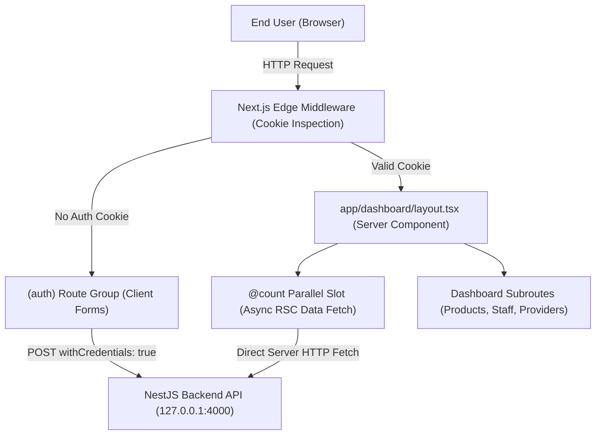

# OXXO Store & Inventory Dashboard (Frontend) 🛒⚡

Modern, accessible retail management web application built with **Next.js 14 (App Router)**, **TypeScript**, **Tailwind CSS**, and **NextUI / HeroUI**. Designed with React Server Components (RSC), Parallel Route slots, Edge Middleware session gating, and zero-layout-shift cookie authentication.

> 🔌 **Companion Backend Repository**: [OXXO Inventory API (`ocso-project`)](../ocso-project/README.md) — Built with NestJS, TypeORM, and PostgreSQL.

---

## 🏛️ Architectural Overview

The application adopts the **Next.js 14 App Router** paradigm, maximizing server-side rendering performance by delegating data-fetching and layout composition to **React Server Components (RSC)** while isolating interactivity into granular **Client Components** (`'use client'`).

```
app/
├── (auth)/                 # Route Group: Isolated authentication layout
│   ├── layout.tsx          # Branded layout with responsive Oxxo vector logo
│   ├── login/page.tsx      # Interactive credential form with HTTP-cookie handling
│   └── signup/page.tsx     # Account registration form
├── dashboard/              # Protected administrative dashboard
│   ├── layout.tsx          # Server Component reading request cookies and slot layout
│   ├── page.tsx            # Primary dashboard analytics overview
│   ├── @count/             # Parallel Route Slot: Asynchronous server-side widget
│   │   ├── page.tsx        # Direct backend data fetch without client hydration
│   │   └── default.tsx     # Slot fallback boundary
│   ├── _components/        # Colocated private presentation components
│   │   ├── header.tsx      # Top bar with branding and user session indicators
│   │   └── sidebar/        # Navigation drawer with active-route feedback
│   ├── employees/page.tsx  # Employee roster and shift management
│   ├── managers/page.tsx   # Store management personnel
│   ├── products/page.tsx   # Inventory catalog, SKUs, and stock tracking
│   └── providers/page.tsx  # Supplier directory and contact logistics
├── providers.tsx           # Client-side NextUI theme provider wrapper
├── globals.css             # Base Tailwind directives and utility layers
└── layout.tsx              # Root HTML document layout with Inter typography
middleware.ts               # Edge Runtime session validator and route guard
```



---

## ⚖️ Architectural Decisions & Trade-Offs

### 1. React Server Components (RSC) by Default
* **Decision**: All layouts and data views default to Server Components, reserving `'use client'` strictly for leaves of the component tree requiring DOM events (`onClick`, `onChange`, `usePathname()`).
* **Benefits**:
  - Eliminates client-side data-fetching waterfalls and `useEffect` race conditions.
  - Substantially decreases client JavaScript bundle size (zero hydration overhead for static UI).
  - Enables direct read-access to HTTP request cookies via `cookies()` from `next/headers` before rendering starts.
* **Trade-Off**: Requires strict mental discipline to keep Server and Client boundaries decoupled, avoiding accidental passing of non-serializable props.

### 2. Parallel Routes (`@slot`) for Modular Dashboard Widgets
* **Decision**: Leveraged Next.js Parallel Routes (`@count`) to render independent dashboard metrics alongside the primary view.
* **Benefits**:
  - Independent loading and error boundaries per widget.
  - Server-side data fetching for metric counters runs in parallel rather than blocking the parent dashboard layout.
* **Trade-Off**: Introduces dedicated file-system naming conventions (`@count/default.tsx`) to prevent 404 unmounts during sub-navigation.

### 3. Edge Runtime Middleware for Session Gating
* **Decision**: Implemented `middleware.ts` running at the V8 Edge layer to intercept unauthorized requests prior to entering the React rendering lifecycle.
* **Benefits**:
  - Immediate redirection with zero client-side layout flashing or unauthorized content exposure.
  - Sub-millisecond execution time by avoiding full Node.js server spin-up.
* **Trade-Off**: Edge runtime restricts usage of certain Node.js core modules and standard crypto libraries; validation relies strictly on cookie presence and lightweight token format inspection.

### 4. NextUI + Tailwind CSS Utility Engine
* **Decision**: Paired Tailwind CSS with NextUI (`@nextui-org/react` / HeroUI) component primitives and `framer-motion`.
* **Benefits**:
  - Accelerated development of consistent, accessible UI components (floating labels, interactive states, focus management).
  - Out-of-the-box micro-interactions and smooth spring animations.
* **Trade-Off**: Increases runtime bundle weight compared to raw Tailwind utility classes; mitigated by modular tree-shaking configured in `tailwind.config.ts`.

---

## 🚀 Tech Stack

| Layer | Technology | Purpose |
|---|---|---|
| **Framework** | Next.js 14.0.0 (App Router) | React framework with hybrid RSC and SSR |
| **Language** | TypeScript 5 | Strict static typing and component contracts |
| **Design System** | Tailwind CSS 3 | Utility-first styling engine |
| **Component Kit** | NextUI / HeroUI | Accessible UI component primitives |
| **Motion** | Framer Motion | Smooth animation transitions and interactive UI |
| **Icons** | React Icons (`react-icons/lu`) | Feather/Lucide vector iconography |
| **Networking** | Axios & Fetch API | HTTP client configured with cross-origin cookie credentials |
| **Package Manager** | `pnpm` | Fast, disk-efficient dependency resolution |

---

## 🛠️ Getting Started

### Prerequisites
- Node.js `>= 18.17.x`
- `pnpm` `>= 9.x`
- Running instance of the [OXXO Inventory API (`ocso-project`)](../ocso-project/README.md) on `http://127.0.0.1:4000`

### 1. Clone & Install Dependencies
```bash
git clone <repository-url>
cd oxxo-front
pnpm install
```

### 2. Environment Configuration
Verify backend routing in [`constants.ts`](file:///C:/Users/USUARIO/Desktop/ReactWorkshop/oxxo-front/constants.ts):
```typescript
export const API_URL = "http://127.0.0.1:4000";
export const TOKEN_NAME = "auth_for_oxxo";
```

### 3. Run Development Server
```bash
pnpm run dev
```

Open [http://localhost:3000](http://localhost:3000) in your browser. The root page automatically resolves to `/login` if unauthenticated.

### 4. Build for Production
```bash
pnpm run build
pnpm run start
```

---

## 🧭 Route Matrix

| Route Path | Type | Access Level | Description |
|---|---|---|---|
| `/` | Server Redirect | Public | Automatically routes to `/login` |
| `/login` | Client Component | Public | Credential authentication form |
| `/signup` | Client Component | Public | New employee/manager onboarding form |
| `/dashboard` | Server Component | Protected | Main inventory and business KPI overview |
| `/dashboard/@count` | Parallel Slot (RSC) | Protected | Server-fetched physical store location counter |
| `/dashboard/products` | Server Component | Protected | Retail catalog, pricing, and stock levels |
| `/dashboard/providers`| Server Component | Protected | Supplier list, contact info, and delivery logistics |
| `/dashboard/employees`| Server Component | Protected | Store staff, shift schedules, and assignments |
| `/dashboard/managers` | Server Component | Protected | Store leadership and management hierarchy |
